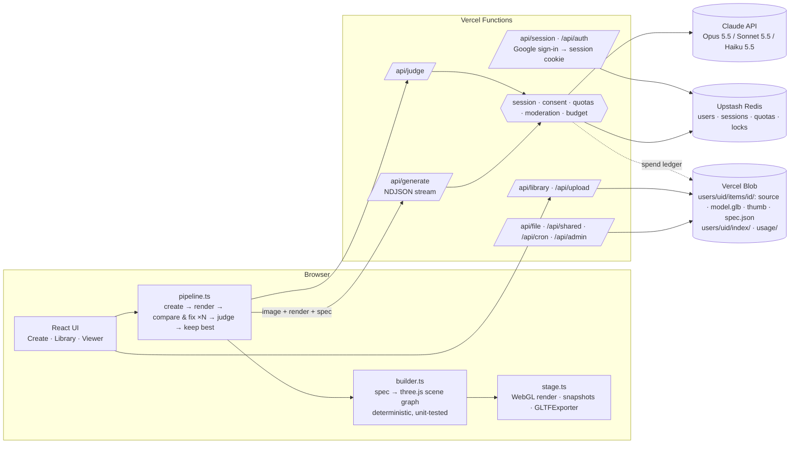

# Image → 3D

Upload one to three images (a photo, sketch or illustration). Claude reads it and writes a **3D illustration spec**: the subject broken into parts, a primitive for each part, proportions, a stylised palette, a pose and a camera. Deterministic code turns that spec into a **three.js model**. Then the app renders the model, shows the render to Claude next to the source image, and asks it to **compare and fix**, for up to three passes, keeping the best version. Finished models go into a **library** with a GLB export, a thumbnail, the source image and the spec.

It's a self-contained app inside the portfolio repo. It shares nothing with the portfolio's `src/`, has its own `package.json`, and deploys to its own Vercel project. It runs on your Anthropic API key, which never leaves the server.

| Gallery | Viewer |
| --- | --- |
|  |  |
| **Generation in progress** | **Generation done (3 versions, best kept)** |
|  |  |

The screenshots come from the e2e suite, which replays recorded Claude responses.

---

## Public launch (Phase 1)

The app is open to the public as a free beta at **3d.agamagarwal.com**: sign in with Google, an invite code to create an account, strict moderation, private storage and hard spend limits. Everything below runs locally in mock mode with no accounts (`npm run dev:mock`); each external service switches on only when its environment variables exist.

### Decisions (Agam can change any of these)

| Decision | Chosen default | Where to change it |
| --- | --- | --- |
| Pricing | Free: **5 models per user per month** (a 3-view job is 1 model; compare-and-fix passes are free), a **$2 per-user daily compute cap**, plus the global daily dollar cap | `MONTHLY_MODELS`, `DAILY_USER_USD`, `DAILY_BUDGET_USD` |
| Sign-in | **Google OAuth** (hand-written code flow in `server/auth.ts`: Auth.js needs a Next/Express host, and this is a Vite SPA on plain Vercel functions; Clerk would be a second vendor for the same result) **plus an invite-code gate** for the beta | `GOOGLE_*`, `INVITE_CODES`, `INVITE_REQUIRED`, `ADMIN_EMAILS` |
| Domain | `3d.agamagarwal.com` (Agam configures the DNS, see below) | `PUBLIC_URL` |
| Moderation | **Strict.** A Haiku check on every image (and the note) before the big model: blocks sexual content, minors, recognisable real faces, graphic violence, weapons and hate symbols. Blocked images are never stored; only a hash is logged. Three blocks in a day pause that account until 00:00 UTC | `server/prompts.ts` (`MODERATION_SYSTEM_PROMPT`) |
| Retention | Source photos deleted **24 h** after upload, models **30 days** after saving | `server/library.ts` (`SOURCE_TTL_MS`, `MODEL_TTL_MS`) |
| One in-flight generation per user; global concurrency | 1 per user, `MAX_CONCURRENT=4` across the deployment, then `503 busy, retry` | `MAX_CONCURRENT` |
| Model-written code | **Removed from the public build** (`LIMITS.customParts = 0`, not in the prompt or the JSON schema, the sandbox worker is not even in the production bundle). Dev only behind `ALLOW_CUSTOM_PARTS=1` + `VITE_ALLOW_CUSTOM_PARTS=1` | `shared/spec.ts` |
| Storage backends | Vercel Blob for files, **Upstash Redis** for accounts, sessions and quotas. **Neon/Postgres is not implemented** (Upstash covers every access pattern; `server/kv.ts` is the 6-method interface a Postgres version would implement) | `server/kv.ts` |
| Sharing | Private by default. An owner can share a read-only link (`/s/<token>`, never the photos); three distinct reports take it down automatically | |

The Terms and Privacy pages (`src/pages/Legal.tsx`) are a plain-language **draft written from what the code does. Have them reviewed before launch.** The consent version is `TERMS_VERSION` in `server/users.ts`; change it to make everyone agree again.

### What Agam has to set up

1. **Google OAuth client** (console.cloud.google.com → APIs & Services → Credentials → Create credentials → OAuth client ID → *Web application*):
   - Authorised JavaScript origin: `https://3d.agamagarwal.com`
   - Authorised redirect URI: `https://3d.agamagarwal.com/api/auth?action=callback` (add `http://localhost:5173/api/auth?action=callback` to try it locally)
   - On the OAuth consent screen: add the scopes `openid`, `email`, `profile`; keep it in *Testing* with your invitees as test users, or publish it (needed once you go beyond 100 users).
   - Copy the client ID and secret into `GOOGLE_CLIENT_ID` / `GOOGLE_CLIENT_SECRET`.
2. **Upstash Redis**: Vercel dashboard → the project → Storage → Marketplace → *Upstash Redis* → create and connect for all environments. That adds `KV_REST_API_URL` and `KV_REST_API_TOKEN` (or set `UPSTASH_REDIS_REST_URL` / `UPSTASH_REDIS_REST_TOKEN` yourself). Accounts and quotas live here; production refuses to run without it.
3. **Vercel Blob** (as before): Storage → Create → Blob → connect (adds `BLOB_READ_WRITE_TOKEN`). The store is public, but the app never reveals a blob URL: files are served through expiring signed `/api/file` links.
4. **Vercel environment variables** (`vercel env add NAME production`, repeat for `preview` if you use previews):

   | Variable | Value |
   | --- | --- |
   | `ANTHROPIC_API_KEY` | your key |
   | `SESSION_SECRET` | `openssl rand -base64 32` (rotating it signs everyone's file links out and invalidates in-flight sign-ins) |
   | `GOOGLE_CLIENT_ID`, `GOOGLE_CLIENT_SECRET` | from step 1 |
   | `PUBLIC_URL` | `https://3d.agamagarwal.com` |
   | `ADMIN_EMAILS` | your Google email (admins skip the invite gate and can open `/admin`) |
   | `INVITE_CODES` | optional shared codes, e.g. `friends-beta`; you can also mint single-use codes at `/admin` |
   | `DAILY_BUDGET_USD` | the global daily cap, e.g. `10` |
   | `MONTHLY_MODELS`, `DAILY_USER_USD`, `MAX_CONCURRENT` | optional; defaults 5, 2, 4 |
   | `CRON_SECRET` | `openssl rand -hex 24`. Vercel Cron sends it as a bearer token; without it the retention job refuses to run |
   | `ALERT_WEBHOOK_URL` | optional Slack-compatible incoming webhook for spend alerts and takedowns |
   | `CONTACT_EMAIL` | optional; shown on the Terms and Privacy pages |

   Never put these in a file or in the repo. Remove any old `APP_PASSWORD`: it is no longer read.
5. **Domain DNS**: in the Vercel project → Settings → Domains add `3d.agamagarwal.com`, then at your DNS host create the record Vercel shows (normally `CNAME 3d → cname.vercel-dns.com`). HTTPS is automatic. Vercel's `x-vercel-forwarded-for` header is what the per-IP limiter trusts.
6. **Anthropic org spend limit**: console.anthropic.com → Settings → Limits → set a monthly spend limit for the workspace/organisation that owns the key (and, ideally, use a dedicated workspace and key for this app). It's the backstop under the app's own daily cap. Also check the org's usage-tier rate limits cover `MAX_CONCURRENT` simultaneous Opus calls.
7. **Cron**: `vercel.json` schedules `/api/cron` daily at 03:00 UTC (the Hobby-plan maximum). On Pro, change it to hourly (`0 * * * *`) so the 24-hour photo retention is exact. Expired files are already refused at read time, so the cron only physically deletes them.
8. **Deploy** from this folder with the CLI (`vercel deploy --prod`), as below. Nothing in this branch deploys itself.
9. Smoke test: sign in, accept the terms, make a model, share it, open the share link signed out, report it, open `/admin`, delete everything.

**Keep the deploys away from `main`.** `main` auto-deploys the portfolio through Amplify. Deploy this app with the CLI. If you later connect the Vercel project to the GitHub repo, set *Root Directory* to `apps/image-to-3d` and use an *Ignored Build Step* (or a dedicated production branch) so that portfolio pushes don't trigger image-to-3d builds.

**Not migrated:** models saved before Phase 1 sit under `i3d/items/` and `i3d/index/` in Blob, outside any user's namespace, so nobody can open them. Download what you want from the Blob dashboard and delete the rest.

**Vercel request limit:** Vercel Functions reject request bodies over 4.5 MB. The browser downsizes every photo to about 1 MB before upload, so three views plus the render fit; the server limit (5 MB per image, 3 images) is for other clients.

### Environment variables

See `.env.example` for every variable with comments. The ones that matter:

| Variable | Required | What it does |
| --- | --- | --- |
| `ANTHROPIC_API_KEY` | yes | Used only by the serverless functions. Never sent to the browser, never logged. |
| `SESSION_SECRET` | yes (production) | Signs OAuth state and file links. |
| `GOOGLE_CLIENT_ID`, `GOOGLE_CLIENT_SECRET` | yes (production) | Google sign-in. |
| `UPSTASH_REDIS_REST_URL`, `UPSTASH_REDIS_REST_TOKEN` | yes (production) | Accounts, sessions, quotas, locks. `KV_REST_API_*` also accepted. |
| `BLOB_READ_WRITE_TOKEN` | yes | Vercel Blob (files). |
| `PUBLIC_URL` | recommended | Public origin for the OAuth redirect. |
| `ADMIN_EMAILS`, `INVITE_CODES`, `INVITE_REQUIRED` | beta | Admins; shared invite codes; whether new accounts need one (default: yes in production). |
| `MONTHLY_MODELS` (5), `DAILY_USER_USD` (2), `DAILY_BUDGET_USD` (5), `MAX_CONCURRENT` (4), `RATE_LIMIT_PER_MINUTE` (12), `MAX_ITEMS_PER_USER` (50), `MAX_REFINE_PASSES` (3) | no | Limits. |
| `CRON_SECRET` | yes (production) | Authorises the retention job. |
| `ALERT_WEBHOOK_URL`, `ALERT_THRESHOLDS` | no | Spend alerts. |
| `CONTACT_EMAIL` | no | Contact on the legal pages. |
| `ANTHROPIC_MOCK`, `MOCK_AUTH`, `MOCK_DELAY_MS`, `DATA_DIR`, `ALLOW_CUSTOM_PARTS` | dev only | Mock mode. Ignored when `VERCEL_ENV=production`. |

Production fails closed: with no Google client, no `SESSION_SECRET` or no Upstash, every API route answers 503 and the UI says sign-in isn't set up.

## Local development

```bash
cd apps/image-to-3d
npm ci
npm run dev:mock     # no key needed: recorded Claude responses; sign in with any email (no password)
# or, with a real key:
cp .env.example .env.local   # fill in ANTHROPIC_API_KEY and MOCK_AUTH=1 (or the Google variables)
npm run dev
```

`npm run dev` serves the Vercel functions in `api/` from the same Vite server, so you don't need `vercel dev`. Without a Blob token, files are stored under `.data/`, and without Upstash accounts and quotas live in `.data/kv.json`, so the whole app runs offline. In mock mode, put `moderation-test-block` in the notes to see the moderation block, and set `MONTHLY_MODELS=1` to see the quota message.

| Command | |
| --- | --- |
| `npm test` | Unit and integration tests (Vitest): spec validation, the spec → three.js builder, the sandbox, pricing, and every server handler with a mocked Claude |
| `npm run test:e2e` | Playwright against the **production build**, served with `vercel.json`'s headers and the fixture replay. Writes `docs/screenshots/` |
| `npm run typecheck` | `tsc --noEmit` across the app, the server and the tests |
| `npm run fixtures` | Regenerates `fixtures/anthropic/*.json` from the spec sources in `scripts/make-fixtures.mjs` |

If Playwright's pinned Chromium isn't installed, point `CHROMIUM_PATH` at any Playwright headless shell you have (for example `~/Library/Caches/ms-playwright/chromium_headless_shell-*/chrome-headless-shell-mac-arm64/chrome-headless-shell`). Otherwise run `npx playwright install chromium` once.

---

## Architecture


<details><summary>Mermaid source</summary>



</details>

### How a generation works

0. **Before any of that** (create only): the images are re-encoded with sharp (EXIF stripped, 5 MB / 4096 px / 3 images), checked by a Haiku moderation call each, and a job is opened; the refine passes and the judge only work on a job whose approved images they reuse.
1. **Spec.** `POST /api/generate {mode:"create"}` streams NDJSON events: status, Claude's summarised thinking, how much JSON has been written, retries, and the result. The server makes one streaming Messages API call with:
   - `output_config.format`: a JSON schema generated from the zod spec schema (`shared/spec.ts`). Structured outputs guarantee schema-shaped JSON. Zod then validates and normalises it anyway: it clamps ranges (structured outputs don't support min/max), repairs duplicate ids, missing parents, parent cycles and unknown materials, and drops degenerate shapes, recording a warning for each repair.
   - `thinking: {type: "adaptive", display: "summarized"}` and a selectable `effort` (default `medium`, which is also Opus 5.5's default).
   - Prompt caching, with `cache_control` on the frozen system prompt and on the source image. Generation and every refinement pass share the same system prompt, schema and first image, so passes read that prefix from the cache.
   - `fallbacks: "default"` (the server-side refusal fallback beta) on Opus and Sonnet. A `refusal` stop reason is reported to the user and never retried.
   - One retry when the output can't be used (invalid JSON, a schema violation, or truncation at `max_tokens`). The validation errors are appended *after* the cached prefix, so the retry still reads the cache.
2. **Build.** `src/three/builder.ts` maps every part to a pivot (position and rotation, plus pose adjustments) that holds a mesh (scale). Children hang off their parent's pivot. `mirrorX` clones a subtree under a `scale.x = -1` group. Primitives: sphere, rounded box, cylinder, cone, capsule, torus, lathe, extrude and tube, with no CSG. Styles change only materials and tessellation: clay is matte standard, toon is a 3-band ramp with inverted-hull outlines, low-poly is faceted non-indexed geometry, and felt is physical sheen with a generated fibre normal map. The builder drops the model onto the ground and frames the spec camera so the whole model is in view.
3. **No model-written code.** Earlier versions let Claude write geometry code (`customParts[].code`) that ran in a sandbox worker. That is gone from the public build: `LIMITS.customParts` is 0, the field is not in the prompt or the JSON schema, `repairSpec` empties it if a model returns it anyway (with a warning), and the worker is compiled out of the production bundle. The code is kept for local experiments behind `ALLOW_CUSTOM_PARTS=1` (server) and `VITE_ALLOW_CUSTOM_PARTS=1` (dev client).
4. **Compare and fix.** The client renders the model from the spec camera at a fixed 768², then sends the render, the source image and the current spec to `mode:"refine"`. Claude scores the *current* render from 0 to 10, lists the differences and the edits it made, and returns a complete revised spec. Passes stop early once the score is ≥ 9.2. A cheap Haiku 5.5 judge scores the final version, and the best-scoring version wins.
5. **Save.** The client exports GLB with GLTFExporter (outline hulls dropped, toon materials baked to PBR) and uploads the GLB, a thumbnail and the source image to `/api/upload`. The server checks each file's magic bytes and size. `/api/library` then validates the spec again and writes it, plus an index entry.

### Storage layout (Vercel Blob + Upstash Redis)

```
i3d/users/<uid>/items/<uuid>/source-<rand>.jpg  model-<rand>.glb  thumb-<rand>.png  spec-<rand>.json
i3d/users/<uid>/index/<ms>-<rand>.json     that user's library index, a new version per write, newest 5 kept
i3d/usage/<YYYY-MM-DD>/<ms>-<rand>-<microdollars>.u   global spend ledger, summed with one list call
```

Redis keys: `user:`, `email:`, `sess:<sha256 of token>`, `invite:`, `q:m:<uid>:<month>` (models), `q:usd:<uid>:<day>`, `lock:user:`, `sem:<n>` (concurrency slots), `job:`, `mod:blocked:<image hash>`, `mod:strikes:`, `share:<token>`, `report:`, `takedown:`, `rl:` (rate-limit windows), `alert:`.

Every user's files sit under their own prefix and no route takes a user id, so one user can't name another's data. **The browser never gets a storage URL.** The library returns `/api/file?p=…&e=<expiry>&s=<HMAC>` links that expire after an hour; `/api/file` checks the signature, the expiry and the retention window, then streams the bytes. Index writes create a new file and reads list the prefix and take the newest, so a CDN can't serve a stale index. The spend ledger keeps each charge in its file *name*, so summing the day's spend takes one `list` and needs no read-modify-write.

### Why Vite + React rather than Next.js

Almost all of this app runs in the browser (WebGL, a Worker, GLTFExporter), and nothing benefits from SSR. Vercel runs plain `api/*.ts` files that use the Web `Request → Response` signature next to any static build, so Next.js would add a framework without removing any code. The same handlers run under Vite in dev (`vite.config.ts`), under Node in the e2e server (`scripts/serve-prod.ts`), and directly in Vitest.

### Security summary

- The API key is read only in `server/claude.ts`, from `ANTHROPIC_API_KEY`. No client code reads env vars, and nothing is prefixed `VITE_` except the dev-only custom-parts flag.
- Accounts: Google sign-in (state-checked, verified email), new accounts behind an invite code, random 256-bit session tokens in an `HttpOnly; Secure; SameSite=Lax` cookie with only the token's hash stored server-side, so signing out or deleting an account takes effect at once. Every data route needs a session and the current Terms consent. Production fails closed without Google, `SESSION_SECRET` or Upstash.
- Model-written code is not part of the public build (see above): no worker, no `unsafe-eval` anywhere. The page CSP allows only same-origin scripts, images and connections.
- Spend is controlled in layers: a per-IP limit (Redis, keyed on `x-vercel-forwarded-for`), one generation in flight per user, a global concurrency semaphore, the monthly model count, a per-user daily dollar cap, the global daily dollar cap recorded after every Claude response (failed attempts and moderation calls included), alerts at 50/80/100 %, and the Anthropic org limit under it all. Refines and the judge only run for a job a create opened, so they can't be called on their own.
- Uploads: every image is decoded and re-encoded with sharp (metadata stripped, 5 MB / 4096 px / pixel-bomb limit / 3 images); GLBs are checked by magic bytes and size; specs are re-validated with zod; JSON bodies must be `application/json`.
- Moderation is strict and automatic; blocked images are never stored and only their SHA-256 is logged. Logs are JSON lines with images, cookies and tokens scrubbed (`server/log.ts`).
- Privacy: per-user namespaces, expiring signed file links, sharing off by default, delete one / delete all / delete account, 24 h photo and 30 day model retention (enforced at read time and swept by the cron).
- The mock client and mock sign-in are disabled in production. No secrets are committed: `.env*` is gitignored, and `.env.example` holds only names.

---

## Cost notes

Prices are per million tokens (Claude API, October 2026):

| Model | Input | Output | Cache write (5 min) | Cache read |
| --- | --- | --- | --- | --- |
| Opus 5.5 (default) | $4 | $20 | $5 | $0.20 |
| Sonnet 5.5 | $2 | $10 | $2.50 | $0.20 |
| Haiku 5.5 (drafts, judge) | $0.10 | $0.50 | $0.125 | $0.01 |

A typical generation, using the token counts recorded in the fixtures (realistic estimates; they weren't measured against your key):

| Step | Tokens | Opus 5.5 cost |
| --- | --- | --- |
| Create the spec | 1.6k input + 4.3k cache write + 7.4k output | ≈ $0.18 |
| Compare & fix, each pass | 3.9k input + 5.7k cache read + ~7–8k output | ≈ $0.16–0.18 |
| Final judge (Haiku 5.5) | 2.9k input + 0.4k output | ≈ $0.0005 |
| **Total, 2 passes** | | **≈ $0.51** |
| Same on Sonnet 5.5 | | ≈ $0.26 |
| Haiku 5.5 draft, 0 passes | | ≈ $0.005 |

- **Output tokens are about 85% of the bill.** Thinking plus the spec JSON dominate, so effort (`low` / `medium` / `high`) and the number of passes are the main levers. Caching saves about $0.02 per pass on the repeated prefix. That's worth having, but it isn't the main saving.
- The UI shows a pre-flight estimate range before you generate, the actual cost after every step, and today's spend against `DAILY_BUDGET_USD` in the header.
- Every response is priced from its own `usage` (input, cache write, cache read, output) and the model that served it, so a server-side fallback is priced at the fallback model's rate.
- To try cheaper defaults, run with Sonnet 5.5 at `medium` effort and 1 pass. Use Haiku 5.5 for quick drafts.

---

## Project layout

```
api/            Vercel Functions (thin: wire a handler to deps)
server/         handlers, Claude client, prompts, auth + users + kv (Upstash | file | memory), quotas, moderation, images (sharp), retention, signing, alerts, logs, budget, storage (Blob | fs), fixture mock
shared/         spec schema (zod → JSON schema), models + pricing (used by client and server)
src/            React app; src/three = geometry, materials, builder, stage, GLB export (sandbox worker is dev-only)
tests/          Vitest: builder, spec, sandbox, pricing, accounts, quotas, moderation, images, privacy, observability, server handlers
e2e/            Playwright: the whole product against the production build
fixtures/       real-shaped Claude responses + the two source images used in tests
scripts/        fixture generators, the dev/prod Node adapter, the production-like server
```
