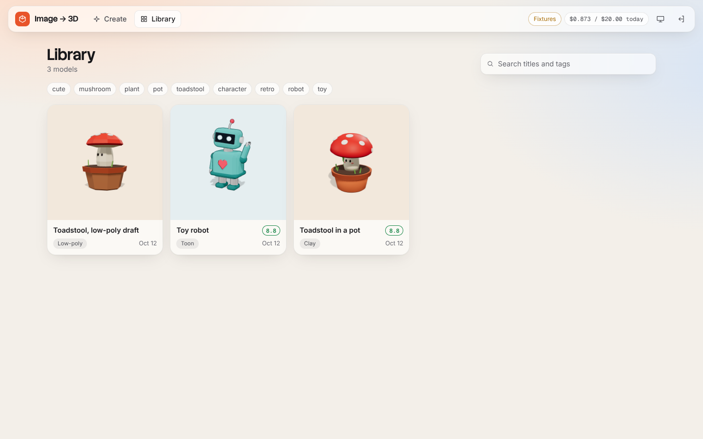
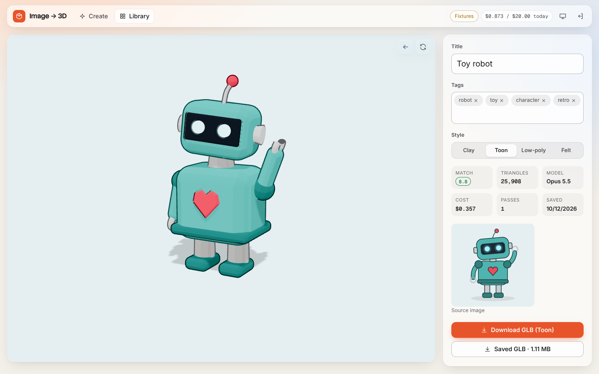
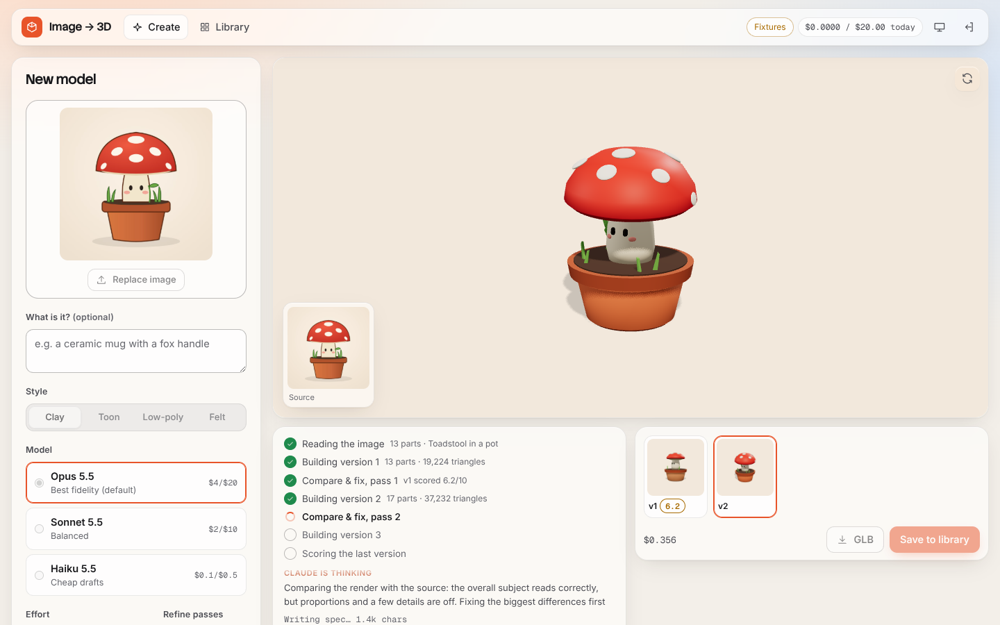
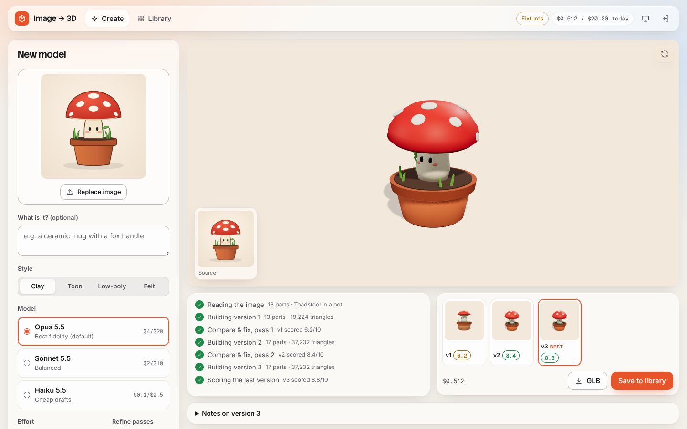
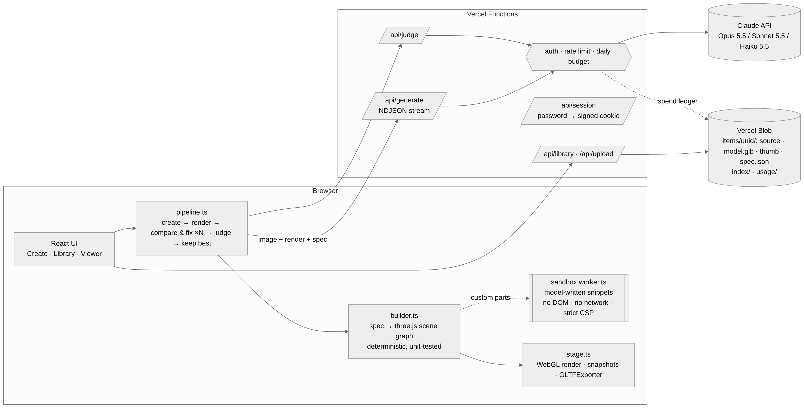
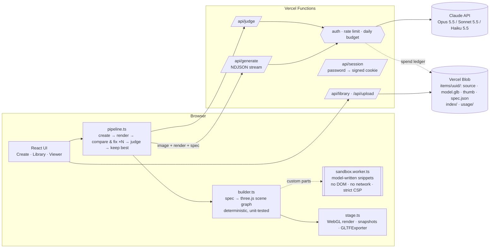

# Image → 3D

Upload an image (a photo, sketch or illustration). Claude reads it and writes a **3D illustration spec**: the subject broken into parts, a primitive for each part, proportions, a stylised palette, a pose and a camera. Deterministic code turns that spec into a **three.js model**. Then the app renders the model, shows the render to Claude next to the source image, and asks it to **compare and fix**, for up to three passes, keeping the best version. Finished models go into a **library** with a GLB export, a thumbnail, the source image and the spec.

It's a self-contained app inside the portfolio repo. It shares nothing with the portfolio's `src/`, has its own `package.json`, and deploys to its own Vercel project. It runs on your Anthropic API key, which never leaves the server.

| Gallery | Viewer |
| --- | --- |
|  |  |
| **Generation in progress** | **Generation done (3 versions, best kept)** |
|  |  |

The screenshots come from the e2e suite, which replays recorded Claude responses.

---

## Deploy (Agam's steps)

You need Node 20+, the Vercel CLI (`npm i -g vercel`) and an Anthropic API key from console.anthropic.com.

```bash
cd apps/image-to-3d
npm ci

# 1. Create and link a new Vercel project. Run this from this folder, so the
#    project root is apps/image-to-3d. Answer "no" to linking an existing
#    project, and call it image-to-3d.
vercel link

# 2. Storage: in the Vercel dashboard, open the project, go to Storage, then
#    Create → Blob (public access) → Connect to the project, for all environments.
#    This adds BLOB_READ_WRITE_TOKEN automatically.

# 3. Secrets (each command prompts for the value)
vercel env add ANTHROPIC_API_KEY production
vercel env add APP_PASSWORD production       # the password you'll type to get in
vercel env add SESSION_SECRET production     # paste the output of: openssl rand -base64 32
vercel env add DAILY_BUDGET_USD production   # e.g. 5

# 4. Ship it
vercel deploy --prod
```

Open the URL, enter `APP_PASSWORD`, drop in an image.

**Keep the deploys away from `main`.** `main` auto-deploys the portfolio through Amplify. Deploy this app with the CLI as shown above. If you later connect the Vercel project to the GitHub repo, set *Root Directory* to `apps/image-to-3d` and use an *Ignored Build Step* (or a dedicated production branch) so that portfolio pushes don't trigger image-to-3d builds.

To use preview deploys (`vercel deploy` without `--prod`), add the same variables for the `preview` environment.

### Environment variables

| Variable | Required | What it does |
| --- | --- | --- |
| `ANTHROPIC_API_KEY` | yes | Used only by the serverless functions. Never sent to the browser, never logged. |
| `APP_PASSWORD` | yes | The access gate. If it isn't set, production fails closed: every API route returns 503 and the UI says it's locked. |
| `SESSION_SECRET` | recommended | Signs the session cookie (HMAC-SHA256). Falls back to a key derived from `APP_PASSWORD`. |
| `BLOB_READ_WRITE_TOKEN` | yes | Vercel Blob. Connecting a Blob store adds it automatically. |
| `DAILY_BUDGET_USD` | no (default 5) | A hard daily cap on Claude spend. Once it's reached, generation returns 402 until 00:00 UTC. |
| `RATE_LIMIT_PER_MINUTE` | no (default 12) | Claude calls per minute per client IP. |
| `MAX_REFINE_PASSES` | no (default 3) | The highest number of compare-and-fix passes the UI offers (0 to 3). |
| `PUBLIC_GALLERY` | no (default false) | Makes the library and viewer public and read-only. Editing still needs the password. |
| `ANTHROPIC_MOCK` | dev only | Set it to `fixtures` to replay recorded responses. Ignored when `VERCEL_ENV=production`. |

---

## Local development

```bash
cd apps/image-to-3d
npm ci
npm run dev:mock     # no key needed: recorded Claude responses, password "letmein"
# or, with a real key:
cp .env.example .env.local   # fill in ANTHROPIC_API_KEY and APP_PASSWORD
npm run dev
```

`npm run dev` serves the Vercel functions in `api/` from the same Vite server, so you don't need `vercel dev`. Without a Blob token, the library is stored under `.data/`.

| Command | |
| --- | --- |
| `npm test` | Unit and integration tests (Vitest): spec validation, the spec → three.js builder, the sandbox, pricing, and every server handler with a mocked Claude |
| `npm run test:e2e` | Playwright against the **production build**, served with `vercel.json`'s headers and the fixture replay. Writes `docs/screenshots/` |
| `npm run typecheck` | `tsc --noEmit` across the app, the server and the tests |
| `npm run fixtures` | Regenerates `fixtures/anthropic/*.json` from the spec sources in `scripts/make-fixtures.mjs` |

In this sandbox, run the e2e suite with `CHROMIUM_PATH=/opt/pw-browsers/chromium-1194/chrome-linux/chrome`. Elsewhere, run `npx playwright install chromium` once.

---

## Architecture



<details><summary>Mermaid source</summary>



</details>

### How a generation works

1. **Spec.** `POST /api/generate {mode:"create"}` streams NDJSON events: status, Claude's summarised thinking, how much JSON has been written, retries, and the result. The server makes one streaming Messages API call with:
   - `output_config.format`: a JSON schema generated from the zod spec schema (`shared/spec.ts`). Structured outputs guarantee schema-shaped JSON. Zod then validates and normalises it anyway: it clamps ranges (structured outputs don't support min/max), repairs duplicate ids, missing parents, parent cycles and unknown materials, and drops degenerate shapes, recording a warning for each repair.
   - `thinking: {type: "adaptive", display: "summarized"}` and a selectable `effort` (default `medium`, which is also Opus 5.5's default).
   - Prompt caching, with `cache_control` on the frozen system prompt and on the source image. Generation and every refinement pass share the same system prompt, schema and first image, so passes read that prefix from the cache.
   - `fallbacks: "default"` (the server-side refusal fallback beta) on Opus and Sonnet. A `refusal` stop reason is reported to the user and never retried.
   - One retry when the output can't be used (invalid JSON, a schema violation, or truncation at `max_tokens`). The validation errors are appended *after* the cached prefix, so the retry still reads the cache.
2. **Build.** `src/three/builder.ts` maps every part to a pivot (position and rotation, plus pose adjustments) that holds a mesh (scale). Children hang off their parent's pivot. `mirrorX` clones a subtree under a `scale.x = -1` group. Primitives: sphere, rounded box, cylinder, cone, capsule, torus, lathe, extrude and tube, with no CSG. Styles change only materials and tessellation: clay is matte standard, toon is a 3-band ramp with inverted-hull outlines, low-poly is faceted non-indexed geometry, and felt is physical sheen with a generated fibre normal map. The builder drops the model onto the ground and frames the spec camera so the whole model is in view.
3. **Sandbox.** For forms the primitives can't express, Claude may write `customParts[].code`, the body of `(THREE, params) => BufferGeometry`. That code never runs on the page. Each snippet gets a fresh module Worker, served with its own `Content-Security-Policy: default-src 'none'; script-src 'self' 'unsafe-eval'`, so it has no network. The worker also removes `fetch`, XHR, WebSocket, `importScripts`, storage and timers before running anything, and poisons `Function.prototype.constructor` against computed-property escapes. A static deny-list is a further layer of defence. The worker is killed after 2.5 s, and its output is validated (vertex budget, finite coordinates within range) before it reaches the scene.
4. **Compare and fix.** The client renders the model from the spec camera at a fixed 768², then sends the render, the source image and the current spec to `mode:"refine"`. Claude scores the *current* render from 0 to 10, lists the differences and the edits it made, and returns a complete revised spec. Passes stop early once the score is ≥ 9.2. A cheap Haiku 5.5 judge scores the final version, and the best-scoring version wins.
5. **Save.** The client exports GLB with GLTFExporter (outline hulls dropped, toon materials baked to PBR) and uploads the GLB, a thumbnail and the source image to `/api/upload`. The server checks each file's magic bytes and size. `/api/library` then validates the spec again and writes it, plus an index entry.

### Storage layout (Vercel Blob)

```
i3d/items/<uuid>/source-<rand>.jpg   model-<rand>.glb   thumb-<rand>.png   spec-<rand>.json
i3d/index/<ms>-<rand>.json           library index, a new version per write, newest 5 kept
i3d/usage/<YYYY-MM-DD>/<ms>-<rand>-<microdollars>.u   spend ledger, summed with one list call
```

Blob URLs are cached by a CDN, so the app never overwrites a path that readers might cache. Index writes create a new file, and reads list the prefix (a fresh API call) and take the newest. The spend ledger keeps each charge in its file *name*, so summing the day's spend takes one `list` and needs no read-modify-write. Item paths are random UUIDs and uploads get random suffixes. The blobs are public but unguessable, which is what lets the GLB be embedded on another site with the viewer's `<model-viewer>` snippet.

### Why Vite + React rather than Next.js

Almost all of this app runs in the browser (WebGL, a Worker, GLTFExporter), and nothing benefits from SSR. Vercel runs plain `api/*.ts` files that use the Web `Request → Response` signature next to any static build, so Next.js would add a framework without removing any code. The same handlers run under Vite in dev (`vite.config.ts`), under Node in the e2e server (`scripts/serve-prod.ts`), and directly in Vitest.

### Security summary

- The API key is read only in `server/claude.ts`, from `ANTHROPIC_API_KEY`. No client code reads env vars, and nothing is prefixed `VITE_`.
- The gate is a password exchanged for an HMAC-signed `HttpOnly; Secure; SameSite=Strict` cookie, with a constant-time compare and login rate limiting. It fails closed in production.
- Spend is controlled three ways: a per-IP rate limit, a hard daily budget recorded after every Claude response (failed attempts included), and a budget check before each call.
- Every upload, image and spec is validated on the server (type, magic bytes, size, schema). JSON bodies must be `application/json`, which, with SameSite=Strict, blocks cross-site form posts.
- The page CSP has no `unsafe-eval` and no third-party scripts. Only the sandbox worker gets `unsafe-eval`, and its CSP is `default-src 'none'`.
- The mock client is disabled in production. No secrets are committed: `.env*` is gitignored, and `.env.example` holds only names.

---

## Cost notes

Prices are per million tokens (Claude API, October 2026):

| Model | Input | Output | Cache write (5 min) | Cache read |
| --- | --- | --- | --- | --- |
| Opus 5.5 (default) | $4 | $20 | $5 | $0.20 |
| Sonnet 5.5 | $2 | $10 | $2.50 | $0.20 |
| Haiku 5.5 (drafts, judge) | $0.10 | $0.50 | $0.125 | $0.01 |

A typical generation, using the token counts recorded in the fixtures (realistic estimates; they weren't measured against your key):

| Step | Tokens | Opus 5.5 cost |
| --- | --- | --- |
| Create the spec | 1.6k input + 4.3k cache write + 7.4k output | ≈ $0.18 |
| Compare & fix, each pass | 3.9k input + 5.7k cache read + ~7–8k output | ≈ $0.16–0.18 |
| Final judge (Haiku 5.5) | 2.9k input + 0.4k output | ≈ $0.0005 |
| **Total, 2 passes** | | **≈ $0.51** |
| Same on Sonnet 5.5 | | ≈ $0.26 |
| Haiku 5.5 draft, 0 passes | | ≈ $0.005 |

- **Output tokens are about 85% of the bill.** Thinking plus the spec JSON dominate, so effort (`low` / `medium` / `high`) and the number of passes are the main levers. Caching saves about $0.02 per pass on the repeated prefix. That's worth having, but it isn't the main saving.
- The UI shows a pre-flight estimate range before you generate, the actual cost after every step, and today's spend against `DAILY_BUDGET_USD` in the header.
- Every response is priced from its own `usage` (input, cache write, cache read, output) and the model that served it, so a server-side fallback is priced at the fallback model's rate.
- To try cheaper defaults, run with Sonnet 5.5 at `medium` effort and 1 pass. Use Haiku 5.5 for quick drafts.

---

## Project layout

```
api/            Vercel Functions (thin: wire a handler to deps)
server/         handlers, Claude client, prompts, auth, rate limit, budget, storage (Blob | fs), fixture mock
shared/         spec schema (zod → JSON schema), models + pricing (used by client and server)
src/            React app; src/three = geometry, materials, builder, stage, GLB export, sandbox worker
tests/          Vitest: builder, spec, sandbox, pricing, server handlers
e2e/            Playwright: the whole product against the production build
fixtures/       real-shaped Claude responses + the two source images used in tests
scripts/        fixture generators, the dev/prod Node adapter, the production-like server
```
